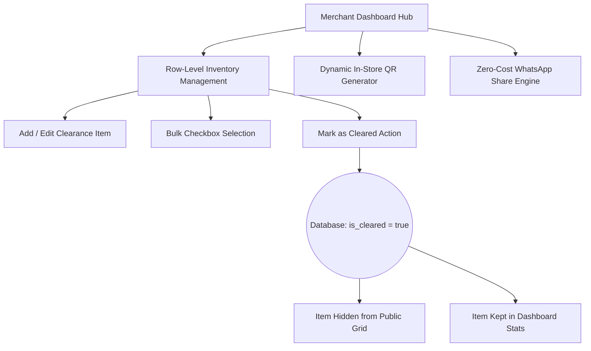

# MVP SPECIFICATION: TRUEATTENDENLY.ONLINE

---

## 1. CORE VALUE PROPOSITION & SYSTEM OBJECTIVE
## bba bba
### The Local Retail Liquidation Imperative
In the hyper-local retail landscape, inventory velocity is the lifeblood of brick-and-mortar survival. Every day an item sits unsold on a shelf:
- It locks up precious working capital.
- It consumes high-value physical retail space.
- It depreciates in value while incurring holding costs.

Traditional methods of clearing "dead stock" (unsold fashion, electronics, cosmetics, or home goods) present severe friction. Merchants must either sell to bulk liquidators for pennies on the rupee or run expensive local advertisements (Meta Ads, print flyers). Local ad campaigns represent a high-cost, high-barrier gamble that requires technical marketing expertise, creative assets, budget overhead, and reliance on complex ad platforms.

At the same time, local everyday shoppers face rising inflation and are actively seeking massive discount opportunities. However, finding these clearances in their neighborhood is a high-friction process of physical wandering, while online discount directories are dominated by large e-commerce players subject to shipping delays and delivery charges.

### The System Objective
**trueattendenly.online** solves this systemic mismatch by acting as a zero-friction, zero-commission, hyper-local clearance marketplace. The platform bridges **zero-cost organic marketing** with **instant inventory liquidation** through three pillars:
1. **Low Friction Onboarding:** Merchants list products in under 2 minutes with no Meta account setup, payment gateway integration, or subscription barriers.
2. **Organic Local Lead Generation:** Unsold stock is listed in a public directory where local buyers find deals by city, shop, and category.
3. **Direct Peer-to-Peer Transactions:** Instead of checking out through an online cart, the buyer connects directly with the shop owner via WhatsApp. The shopper inspects the item in person and buys it over the counter, completely bypassing platform fees, middleman commissions, and shipping wait times.

---

## 2. DISCOVERY & PUBLIC USER EXPERIENCE (BUYER FLOW)

### Route 1: Landing Page Traction (The Conversion Funnel)
To hook local merchants and buyers immediately, the homepage landing section (`src/components/dead-stock-landing.tsx`) acts as the top-of-funnel capture point:
- **Top Announcement Banner:** Enforces 100% English copy focused on immediate profit and clearance value. It uses high-impact micro-copy: `0% Meta Dependency · 100% Margin` and alerts like `70% OFF - FACTORY CLEARANCE` to signal extreme value.
- **Visual Hero Block:** Headlined with *"Turn Dead Stock Into Live Cash"*. It visually communicates how simple physical items (like a premium jacket on a hanger) translate into high-converting digital listings.
- **Merchant Value Hooks:** Focuses on eliminating ad spend and ROI gambling, guiding merchants to log in and start listing, while offering shoppers a direct link to the public directory.

### Route 2: Public Marketplace Grid (`/broadcast/dead-stock`)
The public directory (`src/app/broadcast/dead-stock/page.tsx`) offers a real-time, responsive listing grid designed to work flawlessly on desktop, tablet, and mobile browsers:
- **Unified Search & Categories:** A prominent, clean search bar queries titles and descriptions. Dropdown select inputs allow buyers to filter by specific shop or product category.
- **Dynamic Shop-Wise QR/Domain Trap Routing (`?shopId=[ID]`):** When a merchant prints and displays their storefront QR code, it points to:
  `trueattendenly.online/broadcast/dead-stock?shopId=YOUR_SHOP_UUID`
  Upon loading, the page automatically intercepts the `shopId` query parameter, locking the product grid to display **only** that merchant's active clearance inventory. If the buyer clears the filter, the grid smoothly expands to show all regional shops, drawing foot traffic from one store into the broader ecosystem.

### Route 3: Product Engagement (`/broadcast/dead-stock/[id]`)
When a buyer clicks a product card, they land on the deep engagement page (`src/app/broadcast/dead-stock/[id]`), structured to build absolute buyer trust:
- **Visual Gallery Journey:** Integrates a multi-image layout (supporting 3-4 photos). Users can click thumbnails to swap the active image. 
- **Desktop Hover-Lens Zoom:** Features a Flipkart/Amazon-style magnifying hover lens. Hovering over the active image displays a high-resolution, scale-enhanced close-up overlay, allowing buyers to inspect fabrics, materials, and defects.
- **Mobile Tap Gestures:** Translates hover states into tap-friendly interfaces tailored to touch viewports.
- **Absolute Transparency Badges:** Displays prominent tags like `⚠ DEAD STOCK` or `Factory Clearance - Final Sale`. A detailed `Condition Notes` box outlines exactly why the product is discounted (e.g., "minor cosmetic scratch", "no box", "display piece").
- **Pricing Comparison Engine:** Displays the discounted clearance price side-by-side with the struck-through original price, topped with a bright badge highlighting the exact discount percentage (e.g., `75% OFF`).
- **Pulsing Green WhatsApp CTA:** The primary action button on the page is a pulsing, high-conversion WhatsApp contact button. It uses the client-side intent:
  `https://wa.me/{shop_phone}?text={encoded_message}`
  The message is pre-populated: *"Hi [Shop Name], I saw your clearance deal for '[Product Name]' (₹[Price]) on True Attendly. Is it still available?"* This connects the buyer directly to the merchant's WhatsApp, initiating a direct sales dialogue.

### Universal Navigation Safety
To prevent user abandonment and navigation loops, the public views enforce a viewport-agnostic back button (`src/components/ui/BackButton.tsx`):
- Placed consistently at the top left of deep detail pages.
- Leverages Framer Motion for subtle hover/tap transitions.
- Programmed with dynamic fallback logic: if the user arrived via a direct URL scan (e.g. from an in-store QR code), the button routes them safely back to `/broadcast/dead-stock` rather than breaking on a browser history fallback.

---

## 3. OPERATIONS & MERCHANT EXPERIENCE (SELLER FLOW)

### Route 4: Multi-Shop Merchant Control Center (`/dashboard/dead-stock`)
The merchant control panel (`src/app/dashboard/dead-stock/page.tsx` & `dashboard-client.tsx`) provides high-end, responsive utilities to control inventory lifecycle with tenant isolation:
- **Authentication & Tenant Isolation:** Resolves the merchant's identity on mount using Supabase Auth. The dashboard restricts data access to only those items belonging to the merchant's `shop_id` in the database.
- **Performance Overview Stats:** Features three high-end dashboard cards summarizing liquidation performance:
  1. **Live Items:** The count of active clearance items visible to the public.
  2. **Cleared Items:** The count of sold items archived out of public view.
  3. **Total Liquidation Value:** The aggregate sum of active clearance inventory (e.g. `₹1,24,500`), giving merchants real-time clarity on recovered capital.
- **Row-Level Inventory Control Grid:** A structured list displaying product thumbnails, categories, original vs. clearance pricing, and active status. It includes a multi-checkbox selector for bulk operations (e.g., selecting 10 items and marking them as "Cleared" in a single click).

### Zero-Cost Marketing Engine (WhatsApp Status Mode)
A major bottleneck for local businesses is the requirement to verify a Facebook Business Manager account and get Meta API approval to send automated messages. 
- True Attendly bypasses this friction using client-side **WhatsApp Status Mode** sharing.
- Merchants can copy their storefront link or generate a quick share text containing their hottest deals.
- Clicking the share button launches WhatsApp's native share intent (`https://wa.me/?text=...` with no phone number) which prompts the merchant to share the link directly to **"My Status"** or broadcast lists.
- This unlocks organic, zero-ad-spend local social marketing in seconds, converting personal contacts into physical store traffic.

### In-Store Foot Traffic Capture (Dynamic QR Generator)
Each merchant has a custom QR code widget generated dynamically inside the hub:
- It queries the database for the shop's ID and app URL.
- Uses `https://api.qrserver.com/v1/create-qr-code/` to generate a custom 400x400 QR code pointing to their storefront trap.
- Merchants print and place this QR code at their billing counters. Customers waiting in line scan it, immediately discovering clearance inventory hidden on back shelves or in stockrooms, maximizing in-store purchase value.

### Inventory Lifecycle Control
Maintaining an accurate public marketplace is critical to consumer trust. The system implements a strict lifecycle control:
- **"Mark as Cleared":** When an item sells, the merchant clicks the checkmark action on their dashboard.
- **Database Action:** An async Next.js Server Action updates the product's `is_cleared` field to `true`.
- **Cache Revalidation:** The action triggers a Next.js path revalidation (`revalidatePath`).
- **Immediate Public Hiding:** The item is instantly excluded from the public directory page. However, it is **not deleted**; it remains in the merchant's database records to preserve historic stats and total liquidation value calculations.

---

## 4. DATA ENGINE & CORE PERFORMANCE SPECIFICATIONS

To keep the platform feeling premium, instant, and professional across mobile connections, the system adheres to strict performance architecture boundaries.

### 100% Server-Side Processing
All heavy lifting is delegated to the database layer via Prisma ORM (`src/app/broadcast/dead-stock/actions.ts`):
- **Zero Client-Side Filtering:** Searching, sorting by price (high-to-low / low-to-high), and filtering by category or shop are calculated during the database query.
- **Cursor/Offset Pagination:** The application implements strict server-side pagination (limit of 24 items per request on the public marketplace, and 30 items on the merchant dashboard).
- **Infinite Scroll:** An `IntersectionObserver` sentinel div detects when a user approaches the bottom of the page, triggering a request for the next paginated chunk rather than loading a massive initial payload.

### UX Safeguards Against API Flooding
To protect database connections from exhaustion, the platform implements a client-side **debouncing mechanism**:
- Input fields for search queries wait for a **300ms pause** in typing before updating the state and triggering a server-side database fetch.
- This prevents a database query on every keystroke, reducing API overhead and ensuring a smooth user experience.

### Relational Join Schema (Products & Shops)
Clearance products cannot exist in isolation. The database architecture enforces a strict join relationship:
- Every `DeadStockProduct` is mapped to a parent `Shop` via a foreign key (`shop_id`).
- When products are queried for the marketplace, they include a selected subset of shop fields: `shop_name`, `contact_number`, `location_address`, `city`, and `google_maps_url`.
- This ensures that a single database transaction fetches both product specifications and merchant details, providing all necessary coordinates for the buyer's WhatsApp checkout.

---

## 5. LAUNCH STRATEGY & PHASE 2 ROADMAP

### Day-1 Launch Constraints: The Meta Bypass
The primary launch hurdle for local merchant tools is onboarding friction. True Attendly's Day-1 strategy leverages the zero-cost WhatsApp status route to gain immediate traction:

| Onboarding Parameter | Traditional WhatsApp Business API | True Attendly "Status Mode" Route |
| :--- | :--- | :--- |
| **Setup Cost** | Heavy (Meta developer accounts, API fees) | **₹0 (Completely Free)** |
| **Verification Time** | 1 to 7 Days (Requires business docs, utility bills) | **Instant (Under 2 minutes)** |
| **Message Restrictions** | Strict template guidelines and approval audits | **Unlimited free-form organic text** |
| **Transaction Fees** | Commission on payment gateways | **0% (Cash/Direct UPI over counter)** |

By launching with this model, the platform can scale to hundreds of local merchants immediately without dependency on third-party business verification approvals.

### Phase 2 Trigger: AI Business Partner & Strategic Analytics
Once the platform amasses a baseline of transactions (e.g., active merchant listings, categories, search terms, and WhatsApp click-through rates), it will unlock a premium data-driven analytics suite:
- **Optimal Pricing Calculator:** Analyzes local historical clearance data to recommend the optimal discount tier (e.g., *"Similar Leather Jackets sell 40% faster when discounted by 55% instead of 40%"*).
- **Local Demand Prediction:** Aggregates search bar query volume to inform merchants what local buyers are searching for (e.g., alerting local boutiques that winter wear searches have spiked 150% in their city).
- **AI Business Partner Console:** A proactive assistant that identifies aging stock and drafts WhatsApp Status copy and discount structures to liquidate it, optimizing local retail cash flow.
